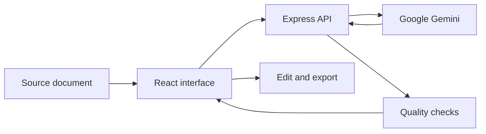

<div align="center">

# TransformX AI

**One source, every message.** Turn a source document into coordinated, channel-ready content with AI-assisted consistency checks.


</div>

## Overview

TransformX AI adapts a source report into communications such as executive summaries, emails, social posts, advisories, slide outlines, FAQs, and more. It also audits generated outputs for conflicting facts and unsupported claims.

## Features

- Generate multiple deliverable formats from one source
- Stream generation through Server-Sent Events
- Review consistency, style, conflicts, and unsupported claims
- Edit outputs, keep versions, and export Markdown files or a combined dossier
- Refine an individual output with targeted instructions

## How it works



## Stack

- **Frontend:** React 19, TypeScript, Vite, Tailwind CSS
- **Backend:** Node.js, Express, TypeScript
- **AI:** Google GenAI SDK

## Requirements

- Node.js 20 or 22
- npm
- Gemini API key from [Google AI Studio](https://aistudio.google.com/)

## Setup

```bash
git clone https://github.com/Harshitsingh666/TransformX-AI.git
cd TransformX-AI
npm install
```

Copy `.env.example` to `.env` and set your API key:

```bash
# macOS / Linux
cp .env.example .env
```

```powershell
# Windows PowerShell
Copy-Item .env.example .env
```

Use the variable names and defaults defined in the checked-in `.env.example`. Keep the local `.env` private.

Start development:

```bash
npm run dev
```

Open [http://localhost:3000](http://localhost:3000).

## Production build

```bash
npm run build
npm start
```

## API

| Route | Method | Purpose |
| --- | --- | --- |
| `/api/health` | GET | Health/configuration check |
| `/api/generate` | POST | Generate one deliverable |
| `/api/generate-stream` | POST | Stream generation with SSE |
| `/api/quality-check` | POST | Audit deliverables for consistency |
| `/api/refine` | POST | Refine an existing output |

The development and production commands depend on the scripts in `package.json`.

## Security

Never commit API keys or put them in frontend code. Use local environment files for development and the host's secret manager for deployment.

## License

See [LICENSE](LICENSE).
